# Introduction

Global Waste Management (GWM) supplies skip bins, rubbish removal and recycling services. It has operated only in New South Wales on paper records and now expands nationally. This report documents an Oracle relational database that supports that growth. The ERD is the contract between the business and the developers: it shows what must be stored, how facts relate, and which rules the database enforces.

The scope covers customers and finance (invoices, payments and supplier payables), ordering, personnel, rostering, timesheets and payroll, company and outsourced vehicles, smart tins, locality administration (councils, dumps, recycling facilities) and business intelligence. The four waste categories are Mixed Rubbish (light), Building Materials (heavy), Concrete and Dirt. Concrete and Dirt are single-material categories.

Key constraints: billing and delivery addresses are separate; heavy waste cannot go in every tin size; every disposal must go to a facility that accepts the category; and the model must work across all Australian states.


# Task Description

The tasks are to: identify entities and attributes with data types; define relationships, cardinality and participation; assign primary and foreign keys; draw and refine an ERD; normalise to 5NF; implement the schema in Oracle SQL; build dashboard queries and show their output; and summarise security and privacy controls.


# Design and Schema Mappings


## Domain assumptions

- An order has one or more order lines. Each line is one physical smart tin of one waste category and size.
- A customer has one billing address. Each order stores its own delivery address and a snapshot of the billing address used at order time, so history is preserved if the customer moves.
- Only permitted category and tin size pairs (CATEGORY_TIN_SIZE) can be priced or ordered, which keeps heavy waste out of large tins. Price depends on that pair, the state and effective dates.
- A job (delivery, pickup or swap) uses one vehicle and a crew of one or more staff.
- Staff are either employees (belong to a depot) or contractors (belong to an outsource supplier). Vehicles follow the same rule.
- Timesheets record hours worked and may link to a rostered shift. Employees are paid fortnightly from approved timesheets: overtime is paid at 1.5 times, tax is withheld at a flat 20 percent and superannuation is 12 percent. These rates are simplified assumptions, not the ATO tax tables. Contractors are not on payroll; their cost reaches GWM through supplier invoices.
- Every address belongs to a council, which determines the facilities and levies for that region.
- All amounts are in AUD. GST is 10 percent.


## Entities and attributes

Data types are Oracle types. Every entity, with every attribute, its data type, key role, nullability and description, is listed below. The table is generated from the SQL script so it always matches the database.

<!-- BEGIN DICTIONARY -->
### Entity 1: STATE

Australian state or territory.

| Attribute | Data type | Key | Null | Description |
|----------------------|---------------|--------|------|-------------------------------------------------|
| state_code | VARCHAR2(3) | PK | No | State or territory code, for example NSW. |
| state_name | VARCHAR2(50) | UK | No | Full state name. |

### Entity 2: COUNCIL

Local government area that administers waste facilities and levies.

| Attribute | Data type | Key | Null | Description |
|----------------------|---------------|--------|------|-------------------------------------------------|
| council_id | NUMBER | PK | No | Surrogate primary key, generated by Oracle. |
| state_code | VARCHAR2(3) | FK | No | References state.state_code. |
| council_name | VARCHAR2(120) |  | No | Official council name. |
| contact_email | VARCHAR2(150) |  | Yes | Contact email address. |
| contact_phone | VARCHAR2(20) |  | Yes | Contact phone number. |
| waste_levy_per_tonne | NUMBER(10,2) |  | No | State waste levy charged per tonne (AUD). |

### Entity 3: ADDRESS

Any physical address, linked to the council that covers it.

| Attribute | Data type | Key | Null | Description |
|----------------------|---------------|--------|------|-------------------------------------------------|
| address_id | NUMBER | PK | No | Surrogate primary key, generated by Oracle. |
| street_line1 | VARCHAR2(150) |  | No | First line of the street address. |
| street_line2 | VARCHAR2(150) |  | Yes | Second line of the street address. |
| suburb | VARCHAR2(80) |  | No | Suburb or locality. |
| state_code | VARCHAR2(3) | FK | No | References state.state_code. |
| postcode | VARCHAR2(4) |  | No | Four digit Australian postcode. |
| council_id | NUMBER | FK | No | References council.council_id. |
| latitude | NUMBER(9,6) |  | Yes | Latitude in decimal degrees. |
| longitude | NUMBER(9,6) |  | Yes | Longitude in decimal degrees. |

### Entity 4: WASTE_CATEGORY

Core waste categories: mixed rubbish, building materials, concrete and dirt.

| Attribute | Data type | Key | Null | Description |
|----------------------|---------------|--------|------|-------------------------------------------------|
| category_id | NUMBER | PK | No | Surrogate primary key, generated by Oracle. |
| category_code | VARCHAR2(10) | UK | No | Short code: MIXED, BUILDING, CONCRETE or DIRT. |
| category_name | VARCHAR2(60) |  | No | Display name of the category. |
| weight_class | VARCHAR2(5) |  | No | LIGHT or HEAVY. |
| description | VARCHAR2(300) |  | Yes | Free text description. |

### Entity 5: COUNCIL_FACILITY

Council dump or recycling facility.

| Attribute | Data type | Key | Null | Description |
|----------------------|---------------|--------|------|-------------------------------------------------|
| facility_id | NUMBER | PK | No | Surrogate primary key, generated by Oracle. |
| council_id | NUMBER | FK | No | References council.council_id. |
| address_id | NUMBER | FK | No | Address of this record. References address.address_id. |
| facility_name | VARCHAR2(120) |  | No | Facility name. |
| facility_type | VARCHAR2(10) |  | No | DUMP or RECYCLING. |
| gate_fee_per_tonne | NUMBER(10,2) |  | No | Gate fee charged per tonne (AUD). |
| operating_hours | VARCHAR2(100) |  | Yes | Opening hours as text. |
| is_active | NUMBER(1) |  | No | 1 if the facility is operating, otherwise 0. |

### Entity 6: FACILITY_ACCEPTED_CATEGORY

Link table: waste categories each facility accepts (M:N).

| Attribute | Data type | Key | Null | Description |
|----------------------|---------------|--------|------|-------------------------------------------------|
| facility_id | NUMBER | PK, FK | No | Part of the primary key. References council_facility.facility_id. |
| category_id | NUMBER | PK, FK | No | Part of the primary key. References waste_category.category_id. |

### Entity 7: TIN_SIZE

Skip bin sizes with volume and maximum load.

| Attribute | Data type | Key | Null | Description |
|----------------------|---------------|--------|------|-------------------------------------------------|
| tin_size_id | NUMBER | PK | No | Surrogate primary key, generated by Oracle. |
| size_code | VARCHAR2(10) | UK | No | Short size code, for example S4. |
| volume_m3 | NUMBER(4,1) | UK | No | Capacity in cubic metres. |
| max_load_kg | NUMBER(8) |  | No | Maximum permitted load in kilograms. |
| description | VARCHAR2(200) |  | Yes | Free text description. |

### Entity 8: CATEGORY_TIN_SIZE

Link table: tin sizes permitted for each waste category (M:N).

| Attribute | Data type | Key | Null | Description |
|----------------------|---------------|--------|------|-------------------------------------------------|
| category_id | NUMBER | PK, FK | No | Part of the primary key. References waste_category.category_id. |
| tin_size_id | NUMBER | PK, FK | No | Part of the primary key. References tin_size.tin_size_id. |

### Entity 9: TIN_PRICE

Hire price for a permitted category and size, by state and effective date.

| Attribute | Data type | Key | Null | Description |
|----------------------|---------------|--------|------|-------------------------------------------------|
| tin_price_id | NUMBER | PK | No | Surrogate primary key, generated by Oracle. |
| category_id | NUMBER | FK | No | References category_tin_size.category_id. |
| tin_size_id | NUMBER | FK | No | References category_tin_size.tin_size_id. |
| state_code | VARCHAR2(3) | FK | No | References state.state_code. |
| hire_price | NUMBER(10,2) |  | No | Hire price in AUD excluding GST. |
| effective_from | DATE |  | No | Date the price takes effect; it applies until a later row for the same combination. |

### Entity 10: DEPOT

Company depot where vehicles, tins and employees are based.

| Attribute | Data type | Key | Null | Description |
|----------------------|---------------|--------|------|-------------------------------------------------|
| depot_id | NUMBER | PK | No | Surrogate primary key, generated by Oracle. |
| address_id | NUMBER | FK, UK | No | Address of this record. References address.address_id. |
| depot_name | VARCHAR2(100) | UK | No | Depot name. |
| phone | VARCHAR2(20) |  | Yes | Phone number. |

### Entity 11: OUTSOURCE_SUPPLIER

External company providing vehicles and staff.

| Attribute | Data type | Key | Null | Description |
|----------------------|---------------|--------|------|-------------------------------------------------|
| supplier_id | NUMBER | PK | No | Surrogate primary key, generated by Oracle. |
| supplier_name | VARCHAR2(120) |  | No | Registered supplier name. |
| abn | VARCHAR2(11) | UK | No | Eleven digit Australian Business Number. |
| contact_name | VARCHAR2(100) |  | Yes | Primary contact person. |
| contact_email | VARCHAR2(150) |  | Yes | Contact email address. |
| contact_phone | VARCHAR2(20) |  | Yes | Contact phone number. |
| daily_vehicle_rate | NUMBER(10,2) |  | No | Daily rate charged per vehicle (AUD). |
| hourly_staff_rate | NUMBER(10,2) |  | No | Hourly rate charged per staff member (AUD). |
| contract_start | DATE |  | No | Contract start date. |
| contract_end | DATE |  | Yes | Contract end date, null while ongoing. |
| supplier_status | VARCHAR2(10) |  | No | ACTIVE, SUSPENDED or ENDED. |

### Entity 12: VEHICLE

Company-owned or outsourced vehicle.

| Attribute | Data type | Key | Null | Description |
|----------------------|---------------|--------|------|-------------------------------------------------|
| vehicle_id | NUMBER | PK | No | Surrogate primary key, generated by Oracle. |
| registration_no | VARCHAR2(10) | UK | No | Vehicle registration plate. |
| vehicle_type | VARCHAR2(15) |  | No | SKIP_TRUCK, HOOK_LIFT, TIPPER or VAN. |
| make | VARCHAR2(50) |  | No | Manufacturer. |
| model | VARCHAR2(50) |  | No | Model name. |
| year_built | NUMBER(4) |  | No | Year of manufacture. |
| capacity_tonnes | NUMBER(5,2) |  | No | Load capacity in tonnes. |
| ownership | VARCHAR2(10) |  | No | OWNED (has a depot) or OUTSOURCED (has a supplier). |
| depot_id | NUMBER | FK | Yes | References depot.depot_id. |
| supplier_id | NUMBER | FK | Yes | References outsource_supplier.supplier_id. |
| vehicle_status | VARCHAR2(15) |  | No | AVAILABLE, IN_USE, MAINTENANCE or RETIRED. |
| next_service_due | DATE |  | Yes | Date the next service is due. |

### Entity 13: VEHICLE_MAINTENANCE

Service, repair and inspection history for a vehicle.

| Attribute | Data type | Key | Null | Description |
|----------------------|---------------|--------|------|-------------------------------------------------|
| maintenance_id | NUMBER | PK | No | Surrogate primary key, generated by Oracle. |
| vehicle_id | NUMBER | FK | No | References vehicle.vehicle_id. |
| service_date | DATE |  | No | Date the work was done. |
| maintenance_type | VARCHAR2(15) |  | No | SERVICE, REPAIR, INSPECTION or TYRES. |
| odometer_km | NUMBER(8) |  | No | Odometer reading in kilometres. |
| cost | NUMBER(10,2) |  | No | Cost in AUD. |
| notes | VARCHAR2(300) |  | Yes | Free text notes. |

### Entity 14: SMART_TIN

Physical IoT-enabled skip bin.

| Attribute | Data type | Key | Null | Description |
|----------------------|---------------|--------|------|-------------------------------------------------|
| tin_id | NUMBER | PK | No | Surrogate primary key, generated by Oracle. |
| tin_serial | VARCHAR2(20) | UK | No | Printed serial number on the tin. |
| tin_size_id | NUMBER | FK | No | References tin_size.tin_size_id. |
| depot_id | NUMBER | FK | No | References depot.depot_id. |
| device_imei | VARCHAR2(15) | UK | No | Fifteen digit IMEI of the IoT device. |
| firmware_version | VARCHAR2(20) |  | Yes | Installed device firmware version. |
| tin_status | VARCHAR2(12) |  | No | AVAILABLE, DEPLOYED, MAINTENANCE or RETIRED. |
| purchase_date | DATE |  | No | Date the tin was purchased. |
| last_seen_at | TIMESTAMP |  | Yes | Time of the latest sensor reading. |

### Entity 15: TIN_TELEMETRY

Sensor readings reported by a smart tin.

| Attribute | Data type | Key | Null | Description |
|----------------------|---------------|--------|------|-------------------------------------------------|
| telemetry_id | NUMBER | PK | No | Surrogate primary key, generated by Oracle. |
| tin_id | NUMBER | FK | No | Smart tin assigned. References smart_tin.tin_id. |
| recorded_at | TIMESTAMP |  | No | Time the reading was recorded. |
| fill_level_pct | NUMBER(5,2) |  | No | How full the tin is, 0 to 100 percent. |
| weight_kg | NUMBER(8,2) |  | No | Measured weight in kilograms. |
| latitude | NUMBER(9,6) |  | Yes | Latitude in decimal degrees. |
| longitude | NUMBER(9,6) |  | Yes | Longitude in decimal degrees. |
| battery_pct | NUMBER(5,2) |  | Yes | Device battery level, 0 to 100 percent. |
| tamper_flag | NUMBER(1) |  | No | 1 if tampering was detected. |

### Entity 16: JOB_POSITION

HR position with a base hourly rate.

| Attribute | Data type | Key | Null | Description |
|----------------------|---------------|--------|------|-------------------------------------------------|
| position_id | NUMBER | PK | No | Surrogate primary key, generated by Oracle. |
| position_title | VARCHAR2(60) | UK | No | Position title. |
| base_hourly_rate | NUMBER(8,2) |  | No | Base hourly pay rate (AUD). |
| requires_licence | NUMBER(1) |  | No | 1 if the position needs a driver licence. |

### Entity 17: STAFF

Company employees and outsourced contractors.

| Attribute | Data type | Key | Null | Description |
|----------------------|---------------|--------|------|-------------------------------------------------|
| staff_id | NUMBER | PK | No | Surrogate primary key, generated by Oracle. |
| employment_type | VARCHAR2(10) |  | No | EMPLOYEE (has a depot) or CONTRACTOR (has a supplier). |
| depot_id | NUMBER | FK | Yes | References depot.depot_id. |
| supplier_id | NUMBER | FK | Yes | References outsource_supplier.supplier_id. |
| position_id | NUMBER | FK | No | References job_position.position_id. |
| address_id | NUMBER | FK | Yes | Address of this record. References address.address_id. |
| first_name | VARCHAR2(60) |  | No | Given name. |
| last_name | VARCHAR2(60) |  | No | Family name. |
| date_of_birth | DATE |  | No | Date of birth. |
| email | VARCHAR2(150) | UK | No | Unique email address. |
| phone | VARCHAR2(20) |  | Yes | Phone number. |
| licence_no | VARCHAR2(20) | UK | Yes | Driver licence number. |
| licence_class | VARCHAR2(5) |  | Yes | Driver licence class. |
| licence_expiry | DATE |  | Yes | Driver licence expiry date. |
| hire_date | DATE |  | No | Start date. |
| termination_date | DATE |  | Yes | End date, null while employed. |
| hourly_rate | NUMBER(8,2) |  | No | Hourly pay rate (AUD). |
| staff_status | VARCHAR2(10) |  | No | ACTIVE, ON_LEAVE or TERMINATED. |

### Entity 18: ROSTER_SHIFT

Rostered shift for a staff member, optionally with a vehicle.

| Attribute | Data type | Key | Null | Description |
|----------------------|---------------|--------|------|-------------------------------------------------|
| shift_id | NUMBER | PK | No | Surrogate primary key, generated by Oracle. |
| staff_id | NUMBER | FK | No | References staff.staff_id. |
| vehicle_id | NUMBER | FK | Yes | References vehicle.vehicle_id. |
| shift_start | TIMESTAMP |  | No | Scheduled start. |
| shift_end | TIMESTAMP |  | No | Scheduled end. |
| shift_status | VARCHAR2(10) |  | No | SCHEDULED, WORKED, ABSENT or CANCELLED. |

### Entity 19: LEAVE_REQUEST

Leave requested by a staff member and its approval.

| Attribute | Data type | Key | Null | Description |
|----------------------|---------------|--------|------|-------------------------------------------------|
| leave_id | NUMBER | PK | No | Surrogate primary key, generated by Oracle. |
| staff_id | NUMBER | FK | No | References staff.staff_id. |
| approver_id | NUMBER | FK | Yes | Staff member who approved it. References staff.staff_id. |
| leave_type | VARCHAR2(10) |  | No | ANNUAL, SICK, UNPAID or CARER. |
| start_date | DATE |  | No | First day of leave. |
| end_date | DATE |  | No | Last day of leave. |
| leave_status | VARCHAR2(10) |  | No | PENDING, APPROVED or REJECTED. |

### Entity 20: TIMESHEET

Hours actually worked, optionally tied to a rostered shift.

| Attribute | Data type | Key | Null | Description |
|----------------------|---------------|--------|------|-------------------------------------------------|
| timesheet_id | NUMBER | PK | No | Surrogate primary key, generated by Oracle. |
| staff_id | NUMBER | FK | No | References staff.staff_id. |
| shift_id | NUMBER | FK, UK | Yes | References roster_shift.shift_id. |
| approver_id | NUMBER | FK | Yes | Staff member who approved it. References staff.staff_id. |
| work_date | DATE |  | No | Calendar date worked. |
| clock_in | TIMESTAMP |  | No | Clock in time. |
| clock_out | TIMESTAMP |  | No | Clock out time. |
| break_minutes | NUMBER(3) |  | No | Unpaid break in minutes. |
| regular_hours | NUMBER(5,2) |  | No | Ordinary hours paid at the base rate. |
| overtime_hours | NUMBER(5,2) |  | No | Overtime hours paid at 1.5 times the rate. |
| timesheet_status | VARCHAR2(10) |  | No | SUBMITTED, APPROVED or REJECTED. |

### Entity 21: PAY_PERIOD

Fortnightly payroll cycle.

| Attribute | Data type | Key | Null | Description |
|----------------------|---------------|--------|------|-------------------------------------------------|
| pay_period_id | NUMBER | PK | No | Surrogate primary key, generated by Oracle. |
| period_start | DATE | UK | No | First day of the period. |
| period_end | DATE |  | No | Last day of the period. |
| pay_date | DATE |  | No | Date employees are paid. |
| period_status | VARCHAR2(10) |  | No | OPEN, CLOSED or PAID. |

### Entity 22: PAYSLIP

Pay calculation for one employee in one pay period.

| Attribute | Data type | Key | Null | Description |
|----------------------|---------------|--------|------|-------------------------------------------------|
| payslip_id | NUMBER | PK | No | Surrogate primary key, generated by Oracle. |
| pay_period_id | NUMBER | FK | No | References pay_period.pay_period_id. |
| staff_id | NUMBER | FK | No | References staff.staff_id. |
| regular_hours | NUMBER(7,2) |  | No | Ordinary hours paid at the base rate. |
| overtime_hours | NUMBER(7,2) |  | No | Overtime hours paid at 1.5 times the rate. |
| hourly_rate | NUMBER(8,2) |  | No | Hourly pay rate (AUD). |
| gross_pay | NUMBER(12,2) |  | No | Gross pay before tax (AUD). |
| tax_withheld | NUMBER(12,2) |  | No | Income tax withheld (AUD). |
| super_amount | NUMBER(12,2) |  | No | Employer superannuation contribution (AUD). |
| net_pay | NUMBER(12,2) |  | No | Take home pay (AUD), gross minus tax. |

### Entity 23: CUSTOMER

Residential, commercial or government customer, holding the billing address.

| Attribute | Data type | Key | Null | Description |
|----------------------|---------------|--------|------|-------------------------------------------------|
| customer_id | NUMBER | PK | No | Surrogate primary key, generated by Oracle. |
| customer_type | VARCHAR2(12) |  | No | RESIDENTIAL, COMMERCIAL or GOVERNMENT. |
| first_name | VARCHAR2(60) |  | Yes | Given name. |
| last_name | VARCHAR2(60) |  | Yes | Family name. |
| company_name | VARCHAR2(120) |  | Yes | Company name for commercial and government customers. |
| abn | VARCHAR2(11) | UK | Yes | Eleven digit Australian Business Number. |
| email | VARCHAR2(150) | UK | No | Unique email address. |
| phone | VARCHAR2(20) |  | No | Phone number. |
| billing_address_id | NUMBER | FK | No | Billing address. References address.address_id. |
| credit_limit | NUMBER(12,2) |  | No | Maximum unpaid balance allowed (AUD). |
| customer_status | VARCHAR2(10) |  | No | ACTIVE, SUSPENDED or CLOSED. |
| created_at | TIMESTAMP |  | No | Time the record was created. |

### Entity 24: CUSTOMER_ORDER

Order header with a separate delivery address and billing snapshot.

| Attribute | Data type | Key | Null | Description |
|----------------------|---------------|--------|------|-------------------------------------------------|
| order_id | NUMBER | PK | No | Surrogate primary key, generated by Oracle. |
| order_number | VARCHAR2(20) | UK | No | Business order number shown to the customer. |
| customer_id | NUMBER | FK | No | References customer.customer_id. |
| billing_address_id | NUMBER | FK | No | Billing address. References address.address_id. |
| delivery_address_id | NUMBER | FK | No | Delivery address for this order, separate from billing. References address.address_id. |
| ordered_at | TIMESTAMP |  | No | Time the order was placed. |
| requested_delivery | DATE |  | No | Requested delivery date. |
| requested_pickup | DATE |  | No | Requested pickup date. |
| site_contact_name | VARCHAR2(100) |  | Yes | Person to contact at the delivery site. |
| site_contact_phone | VARCHAR2(20) |  | Yes | Phone of the site contact. |
| order_status | VARCHAR2(12) |  | No | PLACED, SCHEDULED, DELIVERED, COMPLETED or CANCELLED. |
| notes | VARCHAR2(500) |  | Yes | Free text notes. |

### Entity 25: ORDER_LINE

One smart tin of one waste category and size on an order.

| Attribute | Data type | Key | Null | Description |
|----------------------|---------------|--------|------|-------------------------------------------------|
| order_line_id | NUMBER | PK | No | Surrogate primary key, generated by Oracle. |
| order_id | NUMBER | FK | No | References customer_order.order_id. |
| category_id | NUMBER | FK | No | References category_tin_size.category_id. |
| tin_size_id | NUMBER | FK | No | References category_tin_size.tin_size_id. |
| tin_id | NUMBER | FK | Yes | Smart tin assigned. References smart_tin.tin_id. |
| unit_price | NUMBER(10,2) |  | No | Price charged for the tin (AUD, excluding GST). |

### Entity 26: JOB

Delivery, pickup or swap carried out with one vehicle.

| Attribute | Data type | Key | Null | Description |
|----------------------|---------------|--------|------|-------------------------------------------------|
| job_id | NUMBER | PK | No | Surrogate primary key, generated by Oracle. |
| order_id | NUMBER | FK | No | References customer_order.order_id. |
| vehicle_id | NUMBER | FK | No | References vehicle.vehicle_id. |
| job_type | VARCHAR2(10) |  | No | DELIVERY, PICKUP or SWAP. |
| scheduled_start | TIMESTAMP |  | No | Planned start time. |
| actual_start | TIMESTAMP |  | Yes | Actual start time. |
| actual_end | TIMESTAMP |  | Yes | Actual finish time. |
| job_status | VARCHAR2(12) |  | No | SCHEDULED, IN_PROGRESS, COMPLETED or CANCELLED. |
| outsource_cost | NUMBER(10,2) |  | No | Cost allocated to this job for an outsourced vehicle (AUD). |
| notes | VARCHAR2(300) |  | Yes | Free text notes. |

### Entity 27: JOB_STAFF

Link table: crew members assigned to a job (M:N).

| Attribute | Data type | Key | Null | Description |
|----------------------|---------------|--------|------|-------------------------------------------------|
| job_id | NUMBER | PK, FK | No | Part of the primary key. References job.job_id. |
| staff_id | NUMBER | PK, FK | No | Part of the primary key. References staff.staff_id. |
| job_role | VARCHAR2(10) |  | No | DRIVER or OFFSIDER. |

### Entity 28: DISPOSAL_RECORD

Dump or recycling docket recording weights and fees.

| Attribute | Data type | Key | Null | Description |
|----------------------|---------------|--------|------|-------------------------------------------------|
| disposal_id | NUMBER | PK | No | Surrogate primary key, generated by Oracle. |
| order_line_id | NUMBER | FK | No | References order_line.order_line_id. |
| job_id | NUMBER | FK | No | References job.job_id. |
| facility_id | NUMBER | FK | No | References council_facility.facility_id. |
| docket_number | VARCHAR2(20) | UK | No | Facility docket number. |
| disposed_at | TIMESTAMP |  | No | Time the waste was received. |
| gross_weight_kg | NUMBER(10,2) |  | No | Weight received in kilograms. |
| recycled_weight_kg | NUMBER(10,2) |  | No | Weight diverted to recycling in kilograms. |
| gate_fee | NUMBER(10,2) |  | No | Gate fee charged by the facility (AUD). |

### Entity 29: INVOICE

Customer invoice for an order.

| Attribute | Data type | Key | Null | Description |
|----------------------|---------------|--------|------|-------------------------------------------------|
| invoice_id | NUMBER | PK | No | Surrogate primary key, generated by Oracle. |
| invoice_number | VARCHAR2(20) | UK | No | Business invoice number. |
| order_id | NUMBER | FK | No | References customer_order.order_id. |
| issue_date | DATE |  | No | Date issued. |
| due_date | DATE |  | No | Payment due date. |
| subtotal | NUMBER(12,2) |  | No | Amount excluding GST (AUD). |
| gst_amount | NUMBER(12,2) |  | No | GST at ten percent (AUD). |
| total_amount | NUMBER(12,2) |  | No | Subtotal plus GST (AUD). |
| invoice_status | VARCHAR2(10) |  | No | Current status of the invoice. |

### Entity 30: PAYMENT

Payment received against a customer invoice.

| Attribute | Data type | Key | Null | Description |
|----------------------|---------------|--------|------|-------------------------------------------------|
| payment_id | NUMBER | PK | No | Surrogate primary key, generated by Oracle. |
| invoice_id | NUMBER | FK | No | References invoice.invoice_id. |
| paid_at | TIMESTAMP |  | No | Time the payment was received. |
| amount | NUMBER(12,2) |  | No | Amount paid (AUD). |
| payment_method | VARCHAR2(15) |  | No | CARD, BANK_TRANSFER, CASH or BPAY. |
| reference_no | VARCHAR2(40) |  | Yes | Payment reference. |

### Entity 31: SUPPLIER_INVOICE

Invoice received from an outsource supplier (accounts payable).

| Attribute | Data type | Key | Null | Description |
|----------------------|---------------|--------|------|-------------------------------------------------|
| supplier_invoice_id | NUMBER | PK | No | Surrogate primary key, generated by Oracle. |
| supplier_id | NUMBER | FK | No | References outsource_supplier.supplier_id. |
| supplier_ref | VARCHAR2(30) |  | No | Supplier's own invoice reference. |
| period_start | DATE |  | No | First day of the period. |
| period_end | DATE |  | No | Last day of the period. |
| subtotal | NUMBER(12,2) |  | No | Amount excluding GST (AUD). |
| gst_amount | NUMBER(12,2) |  | No | GST at ten percent (AUD). |
| total_amount | NUMBER(12,2) |  | No | Subtotal plus GST (AUD). |
| due_date | DATE |  | No | Payment due date. |
| paid_date | DATE |  | Yes | Date the supplier was paid. |
| invoice_status | VARCHAR2(10) |  | No | Current status of the invoice. |

### Entity 32: CLOUD_PERFORMANCE_METRIC

Cloud platform performance reading for the BI dashboard.

| Attribute | Data type | Key | Null | Description |
|----------------------|---------------|--------|------|-------------------------------------------------|
| metric_id | NUMBER | PK | No | Surrogate primary key, generated by Oracle. |
| service_name | VARCHAR2(40) |  | No | Platform service being measured. |
| cloud_region | VARCHAR2(20) |  | No | Cloud region, for example ap-southeast-2. |
| metric_name | VARCHAR2(30) |  | No | Name of the metric. |
| metric_value | NUMBER(14,3) |  | No | Measured value. |
| metric_unit | VARCHAR2(15) |  | No | Unit of the value. |
| recorded_at | TIMESTAMP |  | No | Time the reading was recorded. |

### Entity 33: AUDIT_LOG

Record of changes to sensitive data.

| Attribute | Data type | Key | Null | Description |
|----------------------|---------------|--------|------|-------------------------------------------------|
| audit_id | NUMBER | PK | No | Surrogate primary key, generated by Oracle. |
| table_name | VARCHAR2(30) |  | No | Table that was changed. |
| record_id | NUMBER |  | No | Primary key value of the changed row. |
| action_type | VARCHAR2(6) |  | No | INSERT, UPDATE or DELETE. |
| changed_by | VARCHAR2(128) |  | No | Database user that made the change. |
| changed_at | TIMESTAMP |  | No | Time of the change. |
| change_detail | VARCHAR2(1000) |  | Yes | Short description of the change. |

<!-- END DICTIONARY -->


## Relationships and cardinality

Each foreign key in the schema produces one relationship. The parent is the entity referenced, the child holds the foreign key. Participation is Mandatory when the foreign key column is NOT NULL and Optional when it can be null.

<!-- BEGIN RELATIONSHIPS -->
| # | Parent entity | Cardinality | Child entity | Foreign key | Child participation |
|----|------------------------|-----------|------------------------|-----------------------|--------------|
| 1 | STATE | 1:M | COUNCIL | state_code | Mandatory |
| 2 | STATE | 1:M | ADDRESS | state_code | Mandatory |
| 3 | COUNCIL | 1:M | ADDRESS | council_id, state_code | Mandatory |
| 4 | COUNCIL | 1:M | COUNCIL_FACILITY | council_id | Mandatory |
| 5 | ADDRESS | 1:M | COUNCIL_FACILITY | address_id | Mandatory |
| 6 | COUNCIL_FACILITY | 1:M | FACILITY_ACCEPTED_CATEGORY | facility_id | Mandatory |
| 7 | WASTE_CATEGORY | 1:M | FACILITY_ACCEPTED_CATEGORY | category_id | Mandatory |
| 8 | WASTE_CATEGORY | 1:M | CATEGORY_TIN_SIZE | category_id | Mandatory |
| 9 | TIN_SIZE | 1:M | CATEGORY_TIN_SIZE | tin_size_id | Mandatory |
| 10 | CATEGORY_TIN_SIZE | 1:M | TIN_PRICE | category_id, tin_size_id | Mandatory |
| 11 | STATE | 1:M | TIN_PRICE | state_code | Mandatory |
| 12 | ADDRESS | 1:1 | DEPOT | address_id | Mandatory |
| 13 | DEPOT | 1:M | VEHICLE | depot_id | Optional |
| 14 | OUTSOURCE_SUPPLIER | 1:M | VEHICLE | supplier_id | Optional |
| 15 | VEHICLE | 1:M | VEHICLE_MAINTENANCE | vehicle_id | Mandatory |
| 16 | TIN_SIZE | 1:M | SMART_TIN | tin_size_id | Mandatory |
| 17 | DEPOT | 1:M | SMART_TIN | depot_id | Mandatory |
| 18 | SMART_TIN | 1:M | TIN_TELEMETRY | tin_id | Mandatory |
| 19 | DEPOT | 1:M | STAFF | depot_id | Optional |
| 20 | OUTSOURCE_SUPPLIER | 1:M | STAFF | supplier_id | Optional |
| 21 | JOB_POSITION | 1:M | STAFF | position_id | Mandatory |
| 22 | ADDRESS | 1:M | STAFF | address_id | Optional |
| 23 | STAFF | 1:M | ROSTER_SHIFT | staff_id | Mandatory |
| 24 | VEHICLE | 1:M | ROSTER_SHIFT | vehicle_id | Optional |
| 25 | STAFF | 1:M | LEAVE_REQUEST | staff_id | Mandatory |
| 26 | STAFF | 1:M | LEAVE_REQUEST | approver_id | Optional |
| 27 | STAFF | 1:M | TIMESHEET | staff_id | Mandatory |
| 28 | ROSTER_SHIFT | 1:1 | TIMESHEET | shift_id | Optional |
| 29 | STAFF | 1:M | TIMESHEET | approver_id | Optional |
| 30 | PAY_PERIOD | 1:M | PAYSLIP | pay_period_id | Mandatory |
| 31 | STAFF | 1:M | PAYSLIP | staff_id | Mandatory |
| 32 | ADDRESS | 1:M | CUSTOMER | billing_address_id | Mandatory |
| 33 | CUSTOMER | 1:M | CUSTOMER_ORDER | customer_id | Mandatory |
| 34 | ADDRESS | 1:M | CUSTOMER_ORDER | billing_address_id | Mandatory |
| 35 | ADDRESS | 1:M | CUSTOMER_ORDER | delivery_address_id | Mandatory |
| 36 | CUSTOMER_ORDER | 1:M | ORDER_LINE | order_id | Mandatory |
| 37 | CATEGORY_TIN_SIZE | 1:M | ORDER_LINE | category_id, tin_size_id | Mandatory |
| 38 | SMART_TIN | 1:M | ORDER_LINE | tin_id, tin_size_id | Optional |
| 39 | CUSTOMER_ORDER | 1:M | JOB | order_id | Mandatory |
| 40 | VEHICLE | 1:M | JOB | vehicle_id | Mandatory |
| 41 | JOB | 1:M | JOB_STAFF | job_id | Mandatory |
| 42 | STAFF | 1:M | JOB_STAFF | staff_id | Mandatory |
| 43 | ORDER_LINE | 1:M | DISPOSAL_RECORD | order_line_id | Mandatory |
| 44 | JOB | 1:M | DISPOSAL_RECORD | job_id | Mandatory |
| 45 | COUNCIL_FACILITY | 1:M | DISPOSAL_RECORD | facility_id | Mandatory |
| 46 | CUSTOMER_ORDER | 1:M | INVOICE | order_id | Mandatory |
| 47 | INVOICE | 1:M | PAYMENT | invoice_id | Mandatory |
| 48 | OUTSOURCE_SUPPLIER | 1:M | SUPPLIER_INVOICE | supplier_id | Mandatory |

Many-to-many relationships are resolved with link tables: FACILITY_ACCEPTED_CATEGORY (FACILITY AND CATEGORY), CATEGORY_TIN_SIZE (CATEGORY AND TIN_SIZE), JOB_STAFF (JOB AND STAFF).
<!-- END RELATIONSHIPS -->

Two relationships are one-to-one. ADDRESS to DEPOT: a depot occupies exactly one address and no address hosts two depots (`uq_depot_address`). ROSTER_SHIFT to TIMESHEET: a rostered shift has at most one timesheet (`uq_timesheet_shift`). All other relationships are one-to-many, and many-to-many relationships are resolved with link tables.

That an order has at least one line is a transaction rule applied when an order is entered. Oracle cannot enforce a minimum number of child rows declaratively, so the database only guarantees that every line belongs to a valid order.


## Keys

Every table uses a surrogate primary key generated by an Oracle identity column, except STATE (natural key `state_code`) and the three link tables, which use composite keys. All foreign keys are indexed. Business rules are enforced with constraints and composite keys:

- `fk_address_council (council_id, state_code)` stops an address pointing to a council in a different state.
- `fk_line_combo` and `fk_tin_price_combo` allow only permitted waste category and tin size pairs to be ordered or priced.
- `fk_line_tin_size (tin_id, tin_size_id)` guarantees an assigned tin has the size ordered.
- `ck_vehicle_ownership` and `ck_staff_employment` force owned assets and employees to have a depot and outsourced assets and contractors to have a supplier.
- `ck_payslip_gross` and `ck_payslip_net` keep pay calculations consistent.


## Entity Relationship Diagram

The complete ERD shows every entity with all attributes, data types, keys and nullability. Four focused views follow for readability.

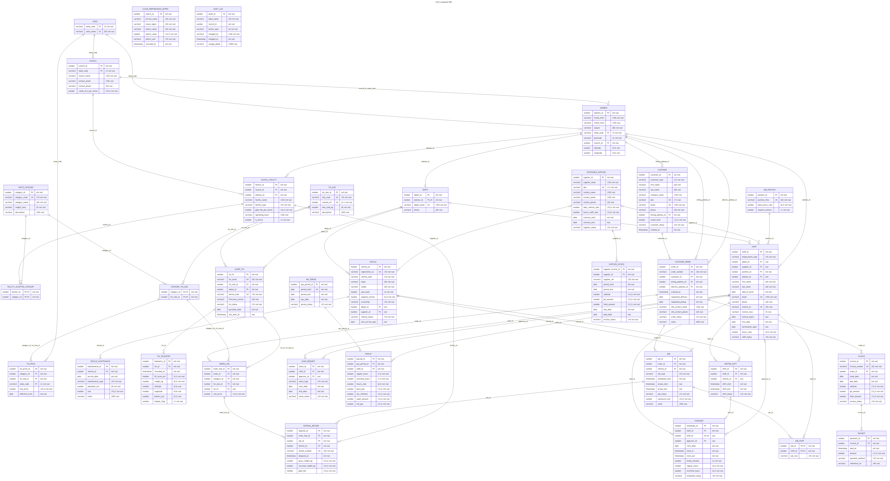

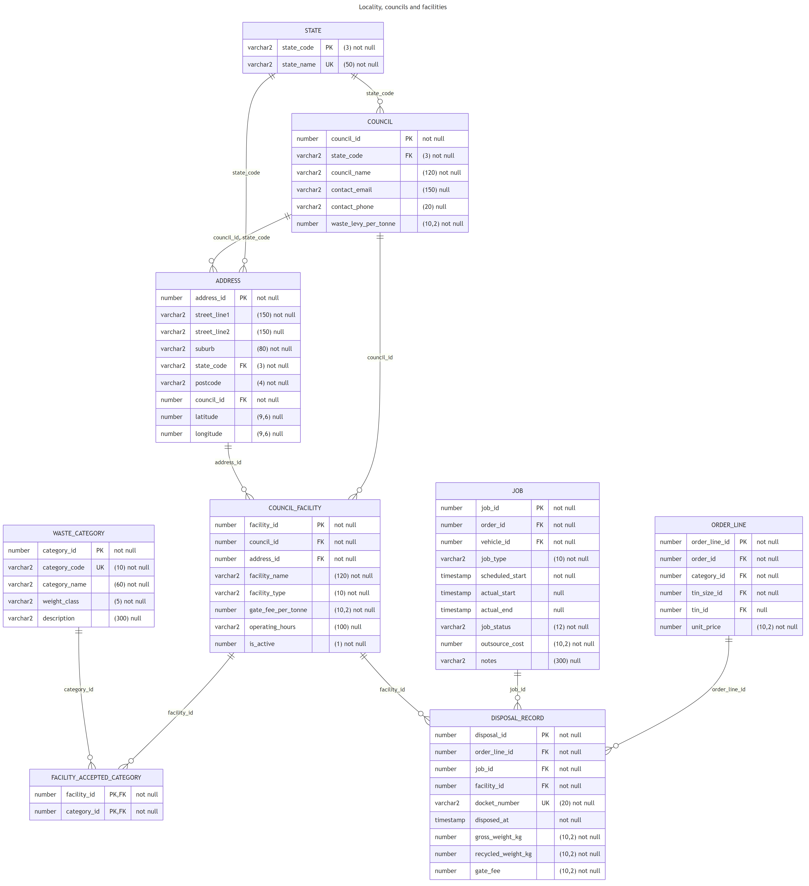

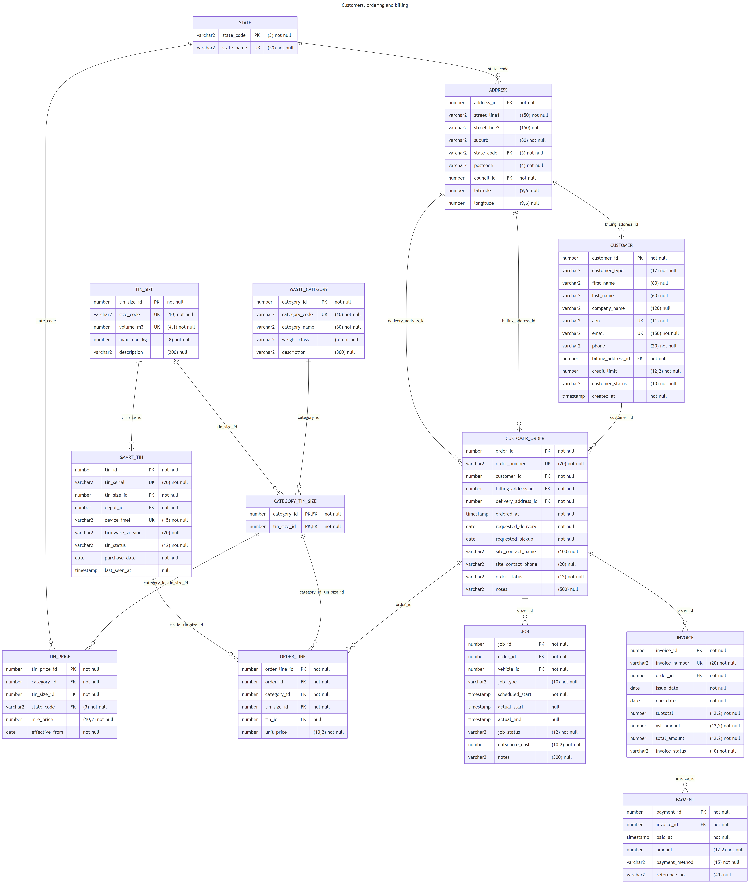

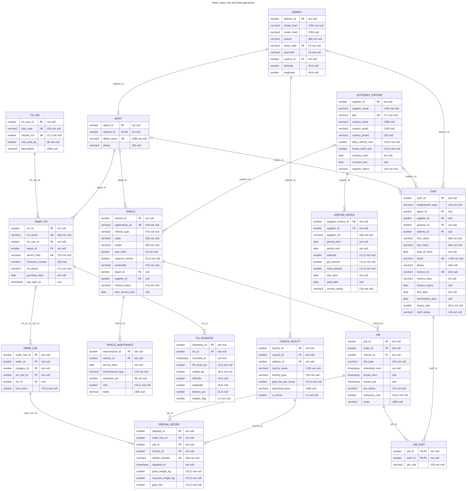

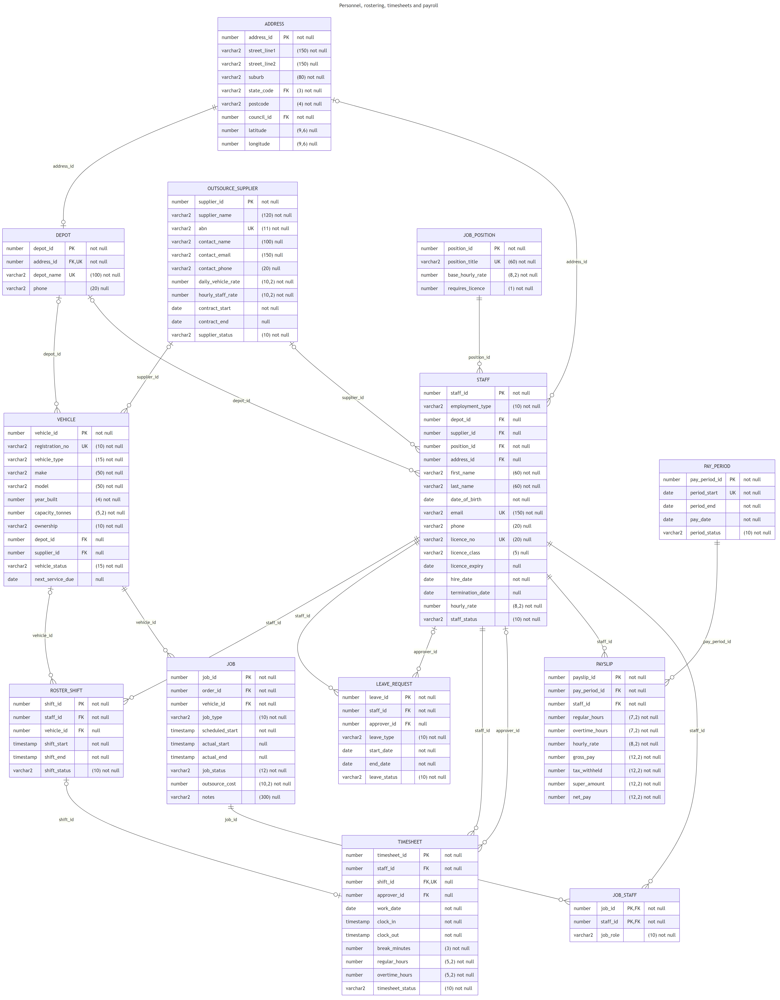

Legend (crow's foot notation): each box is an entity listing its attributes as data type, name, key and a note giving the size and whether the value can be null. PK is the primary key, FK a foreign key and UK a unique key. On a line, `||` means exactly one, `|o` means zero or one, `o|` at the child end means zero or one (a one-to-one link), and `o{` means zero or many. The line label is the foreign key column.

# Normalisation Log

**Unnormalised form (UNF).** A paper order form held customer name, billing and delivery address, tin size, category, price, vehicle, driver, offsider, facility and payment on one sheet, with repeating groups of tins and crew.

**1NF.** Repeating groups were removed. Tins moved to ORDER_LINE and crew to JOB_STAFF. Addresses were split into atomic columns (street, suburb, state, postcode). Every table has a primary key.

**2NF.** Partial dependencies were removed from composite keys. In JOB_STAFF the only non-key attribute (job_role) depends on both job and staff. Customer details depend only on the customer, so they left the order sheet. Tin size attributes (volume, max load) depend only on the size, so they moved to TIN_SIZE. Price depends on category, size, state and date together, so it lives in TIN_PRICE.

**3NF.** Transitive dependencies were removed. The suburb and postcode determine the council, so council moved to ADDRESS and COUNCIL. Council determines state and levy. Position determines base rate (JOB_POSITION). Vehicle make and supplier rates are held once. Pay rates come from the position, and payslips store the rate used so past pay never changes. Invoice carries no customer or address columns, because both are reachable through the order.

**BCNF.** Each determinant is a candidate key. Where a table has more than one candidate key (for example registration_no and vehicle_id), both are declared unique.

**4NF.** Independent multi-valued facts were separated. A facility accepts several categories, and a job has several crew members. These are independent of each other, so each has its own link table rather than a combined table.

**5NF.** Join dependencies were checked. The ternary fact "supplier supplies vehicle used on job by staff" does not need a three-way table: supplier belongs to vehicle and staff individually, and the job links vehicle and crew. All tables can therefore be rebuilt losslessly from their projections.

**Deliberate denormalisation.** CUSTOMER_ORDER stores a billing_address_id snapshot. It repeats information held on CUSTOMER, but it preserves the address printed on past invoices when a customer moves. INVOICE stores subtotal, GST and total, and PAYSLIP stores the hours, rate and pay of each pay run. Both are guarded by check constraints, so historic documents do not change when prices or pay rates change later.


# SQL Code Registry

The whole database is built by one executable file, `sql/gwm_database.sql`. Run it as a DBA on the pluggable database; it drops and recreates the `GWM_OWNER` schema, so it can be rerun safely. Each block starts with a descriptive verb.

| Section | Blocks |
|------------------|----------------------------------------------------------------------------------|
| Setup | Drop Previous Copy of the Schema; Create Schema Owner |
| 1 Tables | Create Table for State, Council, Address, Waste Category, Council Facility, Facility Accepted Category, Tin Size, Category Tin Size, Tin Price, Depot, Outsource Supplier, Vehicle, Vehicle Maintenance, Smart Tin, Tin Telemetry, Job Position, Staff, Roster Shift, Leave Request, Timesheet, Pay Period, Payslip, Customer, Customer Order, Order Line, Job, Job Staff, Disposal Record, Invoice, Payment, Supplier Invoice, Cloud Performance Metric, Audit Log |
| 2 Indexes and triggers | Create Indexes for Foreign Keys; Create Trigger for Disposal Category Check; Create Trigger for Roster Overlap; Create Trigger for Payslip Employee Only; Create Trigger for Tin Double Booking; Create Trigger for Customer Audit |
| 3 Sample data | Insert Reference Data; Insert Addresses; Insert Council Facilities; Insert Category Tin Size Rules; Insert Pricing; Insert Depots, Suppliers and Vehicles; Insert Smart Tins; Insert Staff; Insert Customers; Insert Orders, Jobs, Disposals, Invoices and Telemetry; Insert Roster Shifts; Insert Cloud Metrics; Insert Timesheets; Insert Pay Periods and Payslips; Insert Supplier Invoices |
| 4 Views | Create View for each dashboard (see next section); Create Masked Views |
| 5 Security | Create Roles; Grant Privileges; Create Unified Audit Policies; Create Password Profile |
| 6 Dashboard outputs | Execute Dashboard Queries |
| 7 Integrity tests | Test Rejection of Invalid Data (18 tests, all pass) |

Example (Create Table for Timesheet Entity), reproduced from the script:

```sql
CREATE TABLE timesheet (
    timesheet_id      NUMBER GENERATED ALWAYS AS IDENTITY,
    staff_id          NUMBER        NOT NULL,
    shift_id          NUMBER,
    clock_in          TIMESTAMP     NOT NULL,
    clock_out         TIMESTAMP     NOT NULL,
    regular_hours     NUMBER(5,2)   NOT NULL,
    overtime_hours    NUMBER(5,2)   DEFAULT 0 NOT NULL,
    CONSTRAINT pk_timesheet PRIMARY KEY (timesheet_id),
    CONSTRAINT uq_timesheet_shift UNIQUE (shift_id),
    CONSTRAINT fk_timesheet_staff FOREIGN KEY (staff_id) REFERENCES staff (staff_id),
    CONSTRAINT fk_timesheet_shift FOREIGN KEY (shift_id) REFERENCES roster_shift (shift_id),
    CONSTRAINT ck_timesheet_times CHECK (clock_out > clock_in)
);
```


# SQL Queries and Output Views

Fourteen queries feed the management dashboards. Each one is stored as a view in section 4 of `sql/gwm_database.sql`, so a BI tool reads it like a table, and section 6 executes them with timing switched on. For every dashboard the raw SQL is shown first, followed by the SQL*Plus execution output, including the elapsed time. The final figure shows the integrity tests, where each invalid statement is rejected by the database.

<!-- BEGIN DASHBOARDS -->
## 1. Executive KPIs

```sql
CREATE OR REPLACE VIEW v_dash_executive_kpis AS
SELECT (SELECT NVL(SUM(subtotal), 0) FROM invoice WHERE invoice_status <> 'VOID')                    AS revenue_ex_gst,
       (SELECT NVL(SUM(amount), 0)   FROM payment)                                                   AS cash_collected,
       (SELECT NVL(SUM(total_amount), 0) FROM invoice WHERE invoice_status <> 'VOID')
         - (SELECT NVL(SUM(amount), 0) FROM payment)                                                 AS outstanding_receivables,
       (SELECT COUNT(*) FROM customer_order WHERE order_status IN ('PLACED','SCHEDULED','DELIVERED')) AS open_orders,
       (SELECT COUNT(*) FROM smart_tin WHERE tin_status = 'DEPLOYED')                                AS tins_on_site,
       (SELECT ROUND(100 * SUM(recycled_weight_kg) / SUM(gross_weight_kg), 1) FROM disposal_record)  AS diversion_rate_pct,
       (SELECT NVL(SUM(outsource_cost), 0) FROM job WHERE job_status = 'COMPLETED')                  AS outsource_spend,
       (SELECT COUNT(*) FROM timesheet WHERE timesheet_status = 'SUBMITTED')                         AS timesheets_pending,
       (SELECT NVL(SUM(gross_pay + super_amount), 0) FROM payslip)                                   AS payroll_cost
  FROM dual;
```

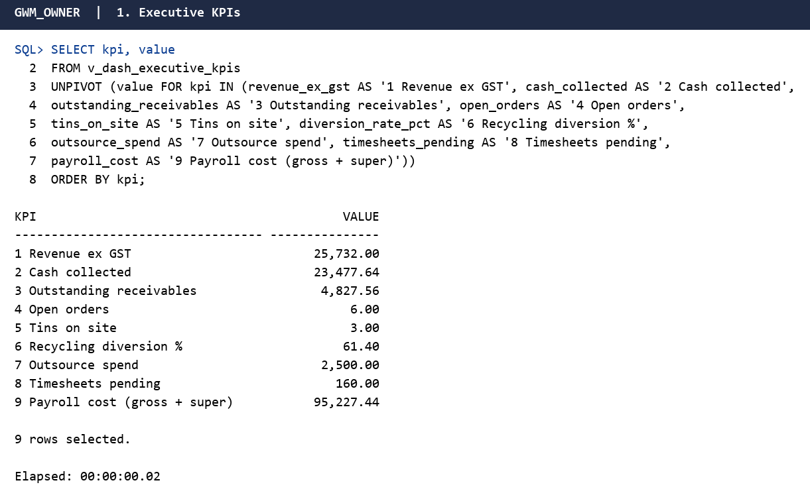

## 2. Monthly revenue by state with month-on-month growth

```sql
CREATE OR REPLACE VIEW v_dash_monthly_revenue AS
WITH monthly AS (
    SELECT TRUNC(o.requested_delivery, 'MM') AS month_start,
           da.state_code,
           COUNT(DISTINCT o.order_id)        AS orders,
           SUM(ol.unit_price)                AS revenue_ex_gst
      FROM customer_order o
      JOIN order_line ol ON ol.order_id = o.order_id
      JOIN address da    ON da.address_id = o.delivery_address_id
     WHERE o.order_status IN ('DELIVERED','COMPLETED')
     GROUP BY TRUNC(o.requested_delivery, 'MM'), da.state_code
)
SELECT month_start,
       state_code,
       orders,
       revenue_ex_gst,
       LAG(revenue_ex_gst) OVER (PARTITION BY state_code ORDER BY month_start) AS prev_month_revenue,
       ROUND(100 * (revenue_ex_gst - LAG(revenue_ex_gst) OVER (PARTITION BY state_code ORDER BY month_start))
             / NULLIF(LAG(revenue_ex_gst) OVER (PARTITION BY state_code ORDER BY month_start), 0), 1) AS mom_growth_pct,
       SUM(revenue_ex_gst) OVER (PARTITION BY state_code ORDER BY month_start) AS running_total
  FROM monthly;
```

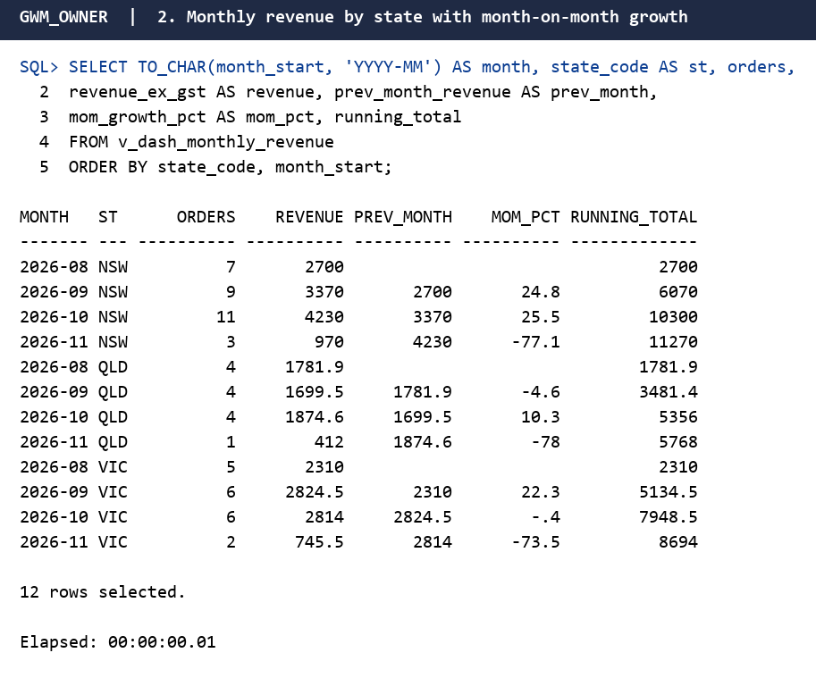

## 3. Waste category mix

```sql
CREATE OR REPLACE VIEW v_dash_category_mix AS
SELECT wc.category_name,
       wc.weight_class,
       COUNT(*)                                   AS tins_hired,
       SUM(ol.unit_price)                         AS revenue_ex_gst,
       ROUND(AVG(ol.unit_price), 2)               AS avg_price,
       ROUND(100 * RATIO_TO_REPORT(SUM(ol.unit_price)) OVER (), 1) AS revenue_share_pct
  FROM order_line ol
  JOIN customer_order o ON o.order_id = ol.order_id
  JOIN waste_category wc ON wc.category_id = ol.category_id
 WHERE o.order_status IN ('DELIVERED','COMPLETED')
 GROUP BY wc.category_name, wc.weight_class;
```

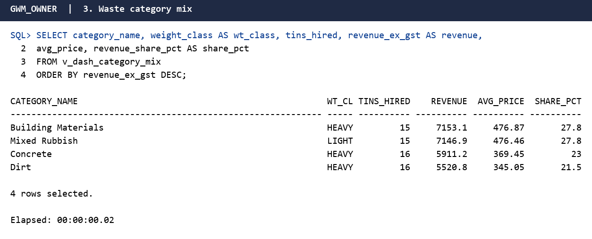

## 4. Receivables ageing

```sql
CREATE OR REPLACE VIEW v_dash_receivables_ageing AS
WITH inv AS (
    SELECT i.invoice_id, o.customer_id, i.due_date,
           i.total_amount - NVL(p.paid, 0) AS balance
      FROM invoice i
      JOIN customer_order o ON o.order_id = i.order_id
      LEFT JOIN (SELECT invoice_id, SUM(amount) paid FROM payment GROUP BY invoice_id) p
             ON p.invoice_id = i.invoice_id
     WHERE i.invoice_status NOT IN ('VOID','DRAFT')
)
SELECT c.customer_id,
       COALESCE(c.company_name, c.first_name || ' ' || c.last_name) AS customer_name,
       c.customer_type,
       SUM(CASE WHEN TRUNC(SYSDATE) - inv.due_date <= 0                THEN inv.balance ELSE 0 END) AS not_yet_due,
       SUM(CASE WHEN TRUNC(SYSDATE) - inv.due_date BETWEEN 1 AND 30    THEN inv.balance ELSE 0 END) AS days_1_30,
       SUM(CASE WHEN TRUNC(SYSDATE) - inv.due_date BETWEEN 31 AND 60   THEN inv.balance ELSE 0 END) AS days_31_60,
       SUM(CASE WHEN TRUNC(SYSDATE) - inv.due_date > 60                THEN inv.balance ELSE 0 END) AS days_over_60,
       SUM(inv.balance)                                               AS total_outstanding,
       c.credit_limit,
       CASE WHEN SUM(inv.balance) > c.credit_limit THEN 'OVER LIMIT' ELSE 'OK' END AS credit_status
  FROM inv
  JOIN customer c ON c.customer_id = inv.customer_id
 WHERE inv.balance > 0
 GROUP BY c.customer_id, COALESCE(c.company_name, c.first_name || ' ' || c.last_name), c.customer_type, c.credit_limit;
```

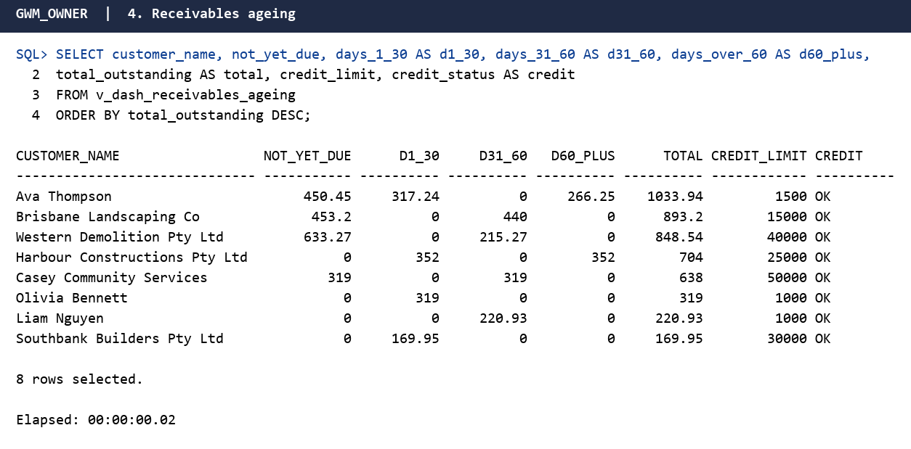

## 5. Customer ranking (Pareto)

```sql
CREATE OR REPLACE VIEW v_dash_customer_ranking AS
WITH spend AS (
    SELECT c.customer_id,
           COALESCE(c.company_name, c.first_name || ' ' || c.last_name) AS customer_name,
           c.customer_type,
           COUNT(DISTINCT o.order_id) AS orders,
           SUM(i.total_amount)        AS total_billed
      FROM customer c
      JOIN customer_order o ON o.customer_id = c.customer_id
      JOIN invoice i        ON i.order_id = o.order_id AND i.invoice_status <> 'VOID'
     GROUP BY c.customer_id, COALESCE(c.company_name, c.first_name || ' ' || c.last_name), c.customer_type
)
SELECT RANK() OVER (ORDER BY total_billed DESC) AS spend_rank,
       customer_name,
       customer_type,
       orders,
       total_billed,
       ROUND(100 * total_billed / SUM(total_billed) OVER (), 1) AS share_pct,
       ROUND(100 * SUM(total_billed) OVER (ORDER BY total_billed DESC
                                           ROWS BETWEEN UNBOUNDED PRECEDING AND CURRENT ROW)
                 / SUM(total_billed) OVER (), 1) AS cumulative_share_pct
  FROM spend;
```

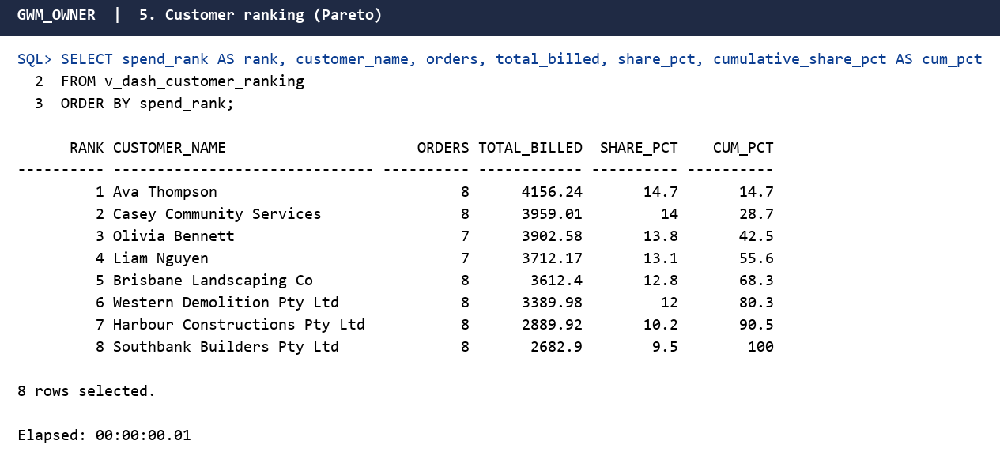

## 6. Fleet performance

```sql
CREATE OR REPLACE VIEW v_dash_fleet_performance AS
SELECT v.registration_no,
       v.vehicle_type,
       v.ownership,
       COALESCE(d.depot_name, s.supplier_name)  AS operated_by,
       NVL(j.jobs_completed, 0)                 AS jobs_completed,
       NVL(j.outsource_cost, 0)                 AS outsource_cost,
       NVL(m.maintenance_cost, 0)               AS maintenance_cost,
       v.next_service_due,
       CASE WHEN v.next_service_due IS NULL            THEN 'N/A (supplier managed)'
            WHEN v.next_service_due < TRUNC(SYSDATE)   THEN 'OVERDUE'
            WHEN v.next_service_due < TRUNC(SYSDATE)+14 THEN 'DUE SOON'
            ELSE 'OK' END                       AS service_status
  FROM vehicle v
  LEFT JOIN depot d               ON d.depot_id = v.depot_id
  LEFT JOIN outsource_supplier s  ON s.supplier_id = v.supplier_id
  LEFT JOIN (SELECT vehicle_id, COUNT(*) jobs_completed, SUM(outsource_cost) outsource_cost
               FROM job WHERE job_status = 'COMPLETED' GROUP BY vehicle_id) j ON j.vehicle_id = v.vehicle_id
  LEFT JOIN (SELECT vehicle_id, SUM(cost) maintenance_cost
               FROM vehicle_maintenance GROUP BY vehicle_id) m ON m.vehicle_id = v.vehicle_id;
```

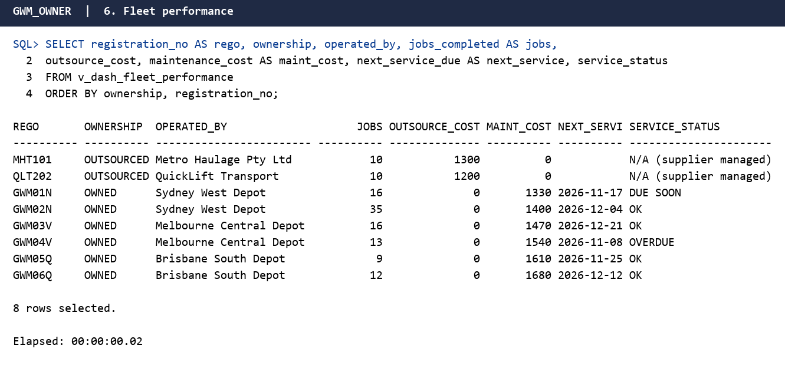

## 7. Staff utilisation (last 14 days)

```sql
CREATE OR REPLACE VIEW v_dash_staff_utilisation AS
SELECT s.staff_id,
       s.first_name || ' ' || s.last_name AS staff_name,
       s.employment_type,
       p.position_title,
       COUNT(CASE WHEN r.shift_status = 'WORKED' THEN 1 END) AS shifts_worked,
       COUNT(CASE WHEN r.shift_status = 'ABSENT' THEN 1 END) AS shifts_absent,
       NVL(SUM(CASE WHEN r.shift_status = 'WORKED'
                    THEN (CAST(r.shift_end AS DATE) - CAST(r.shift_start AS DATE)) * 24 END), 0) AS hours_worked,
       ROUND(NVL(SUM(CASE WHEN r.shift_status = 'WORKED'
                    THEN (CAST(r.shift_end AS DATE) - CAST(r.shift_start AS DATE)) * 24 END), 0) * s.hourly_rate, 2) AS labour_cost
  FROM staff s
  JOIN job_position p ON p.position_id = s.position_id
  LEFT JOIN roster_shift r ON r.staff_id = s.staff_id
                          AND r.shift_start >= TRUNC(SYSDATE) - 14
                          AND r.shift_start <  TRUNC(SYSDATE)
 WHERE s.staff_status <> 'TERMINATED'
 GROUP BY s.staff_id, s.first_name, s.last_name, s.employment_type, p.position_title, s.hourly_rate;
```

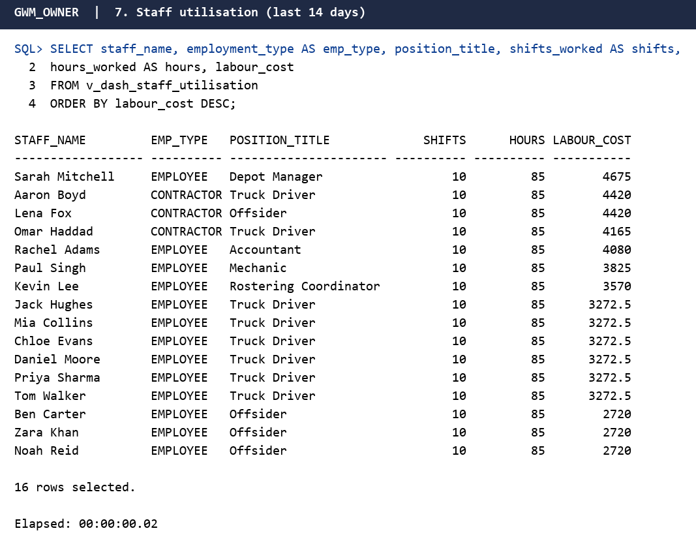

## 8. Recycling diversion by facility

```sql
CREATE OR REPLACE VIEW v_dash_recycling_diversion AS
SELECT st.state_code,
       c.council_name,
       f.facility_name,
       f.facility_type,
       COUNT(*)                                          AS dockets,
       ROUND(SUM(dr.gross_weight_kg) / 1000, 2)          AS tonnes_received,
       ROUND(SUM(dr.recycled_weight_kg) / 1000, 2)       AS tonnes_recycled,
       ROUND(100 * SUM(dr.recycled_weight_kg) / SUM(dr.gross_weight_kg), 1) AS diversion_rate_pct,
       SUM(dr.gate_fee)                                  AS gate_fees_paid
  FROM disposal_record dr
  JOIN council_facility f ON f.facility_id = dr.facility_id
  JOIN council c          ON c.council_id = f.council_id
  JOIN state st           ON st.state_code = c.state_code
 GROUP BY st.state_code, c.council_name, f.facility_name, f.facility_type;
```

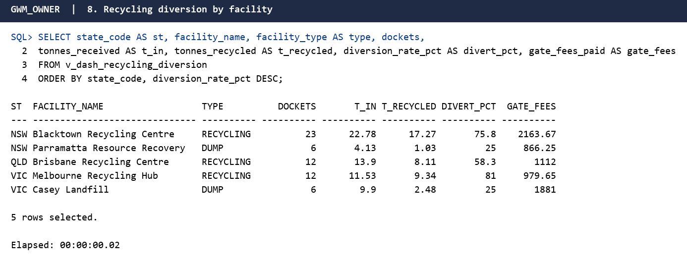

## 9. Smart tin status

```sql
CREATE OR REPLACE VIEW v_dash_smart_tin_status AS
WITH latest AS (
    SELECT t.*, ROW_NUMBER() OVER (PARTITION BY t.tin_id ORDER BY t.recorded_at DESC) rn
      FROM tin_telemetry t
)
SELECT st.tin_serial,
       sz.size_code,
       st.tin_status,
       l.recorded_at         AS last_reading_at,
       l.fill_level_pct,
       l.weight_kg,
       l.battery_pct,
       CASE WHEN l.tamper_flag = 1         THEN 'TAMPER ALERT'
            WHEN l.battery_pct < 40        THEN 'LOW BATTERY'
            WHEN l.fill_level_pct >= 75 AND st.tin_status = 'DEPLOYED' THEN 'PICKUP DUE'
            WHEN st.tin_status = 'MAINTENANCE' THEN 'IN MAINTENANCE'
            ELSE 'NORMAL' END AS alert
  FROM smart_tin st
  JOIN tin_size sz ON sz.tin_size_id = st.tin_size_id
  LEFT JOIN latest l ON l.tin_id = st.tin_id AND l.rn = 1;
```

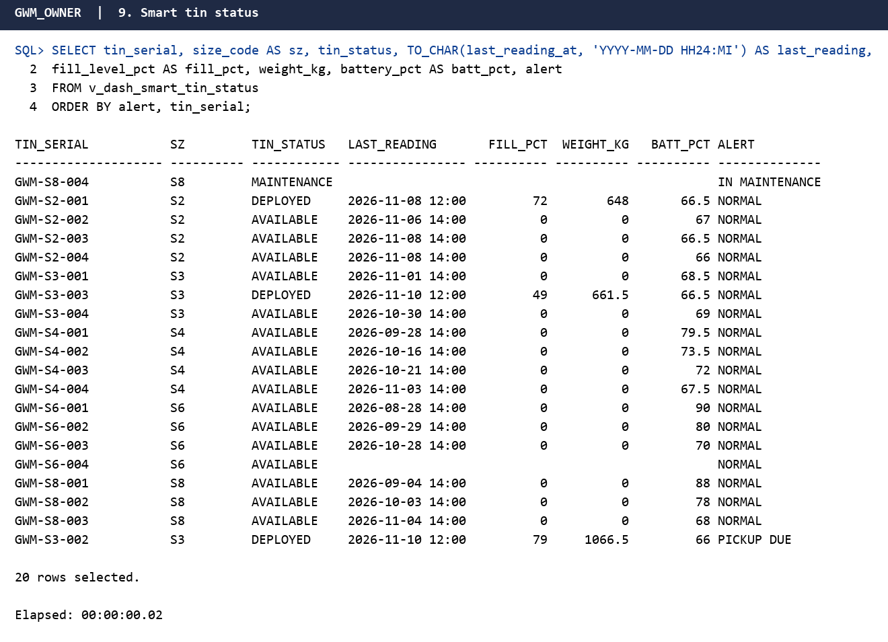

## 10. Order pipeline

```sql
CREATE OR REPLACE VIEW v_dash_order_pipeline AS
SELECT o.order_status,
       da.state_code,
       COUNT(DISTINCT o.order_id) AS orders,
       SUM(ol.unit_price)         AS order_value_ex_gst,
       MIN(o.requested_delivery)  AS earliest_delivery,
       MAX(o.requested_pickup)    AS latest_pickup
  FROM customer_order o
  JOIN order_line ol ON ol.order_id = o.order_id
  JOIN address da    ON da.address_id = o.delivery_address_id
 GROUP BY o.order_status, da.state_code;
```

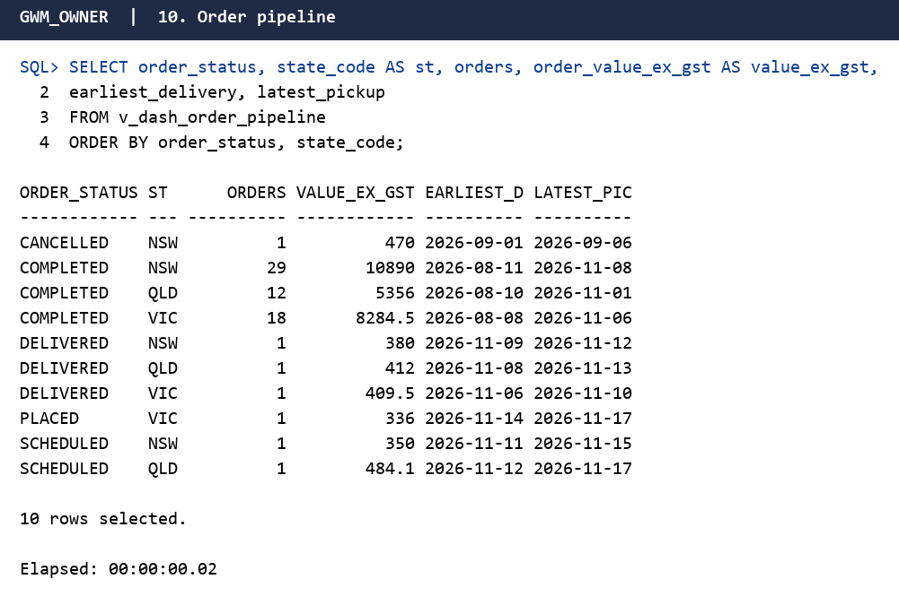

## 11. Cloud performance SLA

```sql
CREATE OR REPLACE VIEW v_dash_cloud_sla AS
SELECT service_name,
       cloud_region,
       ROUND(AVG(CASE WHEN metric_name = 'CPU_PCT'    THEN metric_value END), 1) AS avg_cpu_pct,
       ROUND(MAX(CASE WHEN metric_name = 'CPU_PCT'    THEN metric_value END), 1) AS peak_cpu_pct,
       ROUND(AVG(CASE WHEN metric_name = 'MEMORY_PCT' THEN metric_value END), 1) AS avg_mem_pct,
       ROUND(PERCENTILE_CONT(0.95) WITHIN GROUP (ORDER BY CASE WHEN metric_name = 'LATENCY_MS' THEN metric_value END), 1) AS p95_latency_ms,
       COUNT(CASE WHEN metric_name = 'LATENCY_MS' AND metric_value > 250 THEN 1 END) AS hours_latency_breach,
       ROUND(AVG(CASE WHEN metric_name = 'ERROR_RATE_PCT' THEN metric_value END), 3) AS avg_error_rate_pct,
       ROUND(SUM(CASE WHEN metric_name = 'REQUESTS_PER_MIN' THEN metric_value END) * 60) AS total_requests,
       CASE WHEN PERCENTILE_CONT(0.95) WITHIN GROUP (ORDER BY CASE WHEN metric_name = 'LATENCY_MS' THEN metric_value END) > 250
            THEN 'SLA BREACH' ELSE 'WITHIN SLA' END AS sla_status
  FROM cloud_performance_metric
 GROUP BY service_name, cloud_region;
```

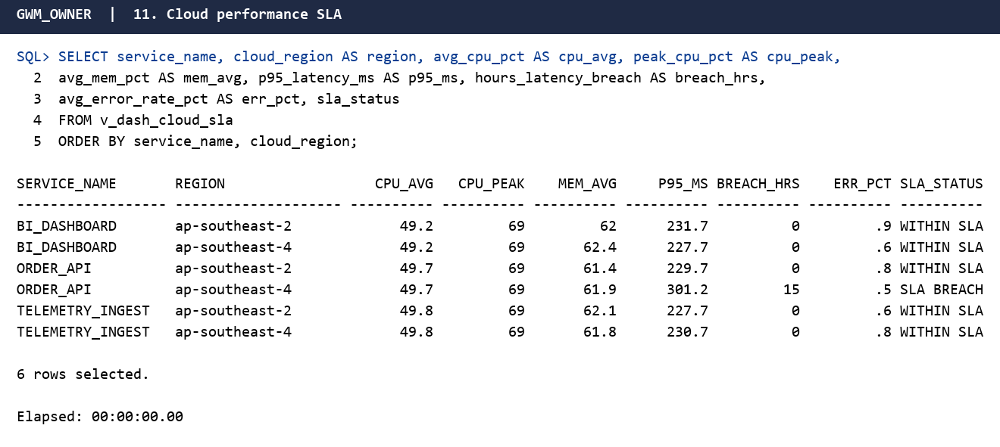

## 12. Payroll summary

```sql
CREATE OR REPLACE VIEW v_dash_payroll_summary AS
SELECT pp.pay_period_id,
       pp.period_start,
       pp.period_end,
       pp.pay_date,
       pp.period_status,
       COUNT(ps.payslip_id)                           AS employees_paid,
       NVL(SUM(ps.regular_hours), 0)                  AS regular_hours,
       NVL(SUM(ps.overtime_hours), 0)                 AS overtime_hours,
       ROUND(100 * NVL(SUM(ps.overtime_hours), 0)
             / NULLIF(NVL(SUM(ps.regular_hours), 0) + NVL(SUM(ps.overtime_hours), 0), 0), 1) AS overtime_pct,
       NVL(SUM(ps.gross_pay), 0)                      AS gross_pay,
       NVL(SUM(ps.tax_withheld), 0)                   AS tax_withheld,
       NVL(SUM(ps.super_amount), 0)                   AS super_amount,
       NVL(SUM(ps.net_pay), 0)                        AS net_pay,
       NVL(SUM(ps.gross_pay + ps.super_amount), 0)    AS employer_cost,
       (SELECT COUNT(*) FROM timesheet t
         WHERE t.work_date BETWEEN pp.period_start AND pp.period_end
           AND t.timesheet_status = 'SUBMITTED')      AS timesheets_awaiting_approval
  FROM pay_period pp
  LEFT JOIN payslip ps ON ps.pay_period_id = pp.pay_period_id
 GROUP BY pp.pay_period_id, pp.period_start, pp.period_end, pp.pay_date, pp.period_status;
```

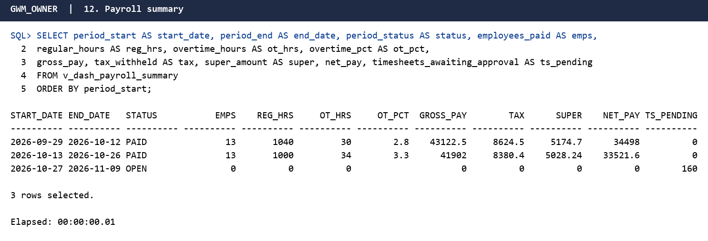

## 13. Supplier payables

```sql
CREATE OR REPLACE VIEW v_dash_supplier_payables AS
SELECT s.supplier_name,
       COUNT(si.supplier_invoice_id)                                                    AS invoices,
       NVL(SUM(si.total_amount), 0)                                                     AS total_invoiced,
       NVL(SUM(CASE WHEN si.invoice_status = 'PAID' THEN si.total_amount END), 0)       AS total_paid,
       NVL(SUM(CASE WHEN si.invoice_status <> 'PAID' THEN si.total_amount END), 0)      AS outstanding,
       NVL(SUM(CASE WHEN si.invoice_status <> 'PAID' AND si.due_date < TRUNC(SYSDATE)
                    THEN si.total_amount END), 0)                                       AS overdue
  FROM outsource_supplier s
  LEFT JOIN supplier_invoice si ON si.supplier_id = s.supplier_id
 GROUP BY s.supplier_name;
```

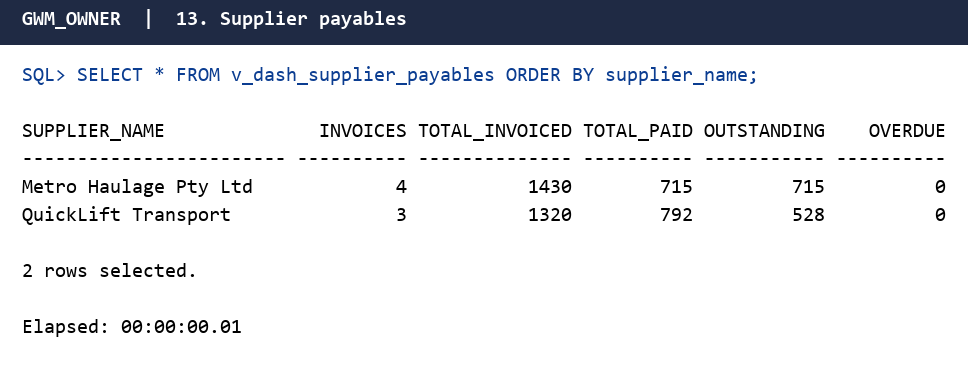

## 14. Masked customer view

```sql
CREATE OR REPLACE VIEW v_customer_masked AS
SELECT customer_id,
       customer_type,
       COALESCE(company_name, SUBSTR(first_name, 1, 1) || '. ' || last_name) AS display_name,
       SUBSTR(email, 1, 1) || '***' || SUBSTR(email, INSTR(email, '@'))    AS email_masked,
       '******' || SUBSTR(phone, -4)                                        AS phone_masked,
       customer_status
  FROM customer;
```

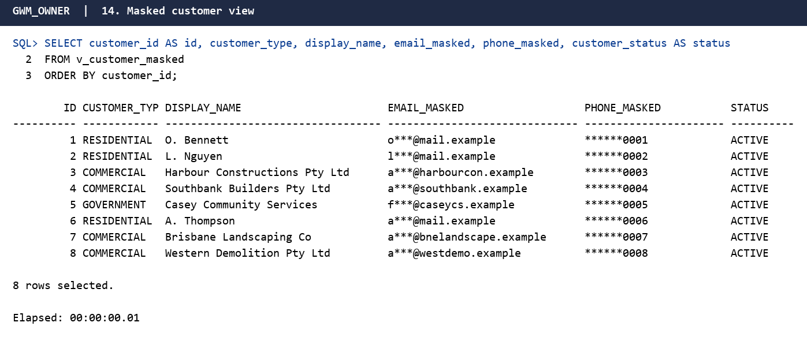

## Integrity test results

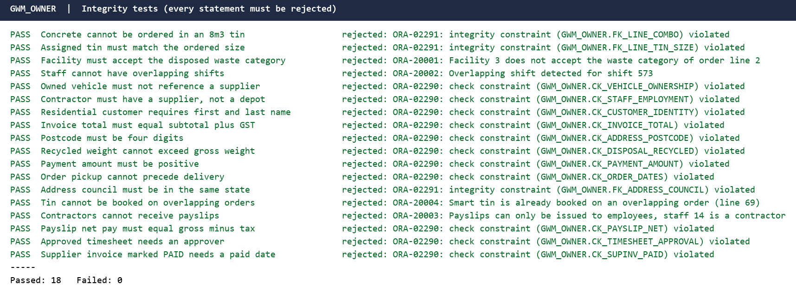

<!-- END DASHBOARDS -->


# Security and Privacy Policy

GWM holds personal information, so the database follows the Australian Privacy Principles under the Privacy Act 1988 (Office of the Australian Information Commissioner, n.d.).

- **Least privilege.** Four roles (BI reader, finance, operations, HR) hold only the grants they need. Only HR can read raw staff data.
- **Data minimisation and masking.** BI users read `v_customer_masked` and `v_staff_masked`, which hide email, phone, licence and pay data.
- **Auditing.** A trigger records customer changes in AUDIT_LOG. Unified audit policies record reads and changes of customer, staff and payslip tables and all privilege changes.
- **Payroll confidentiality.** Only the HR role can change timesheets and payslips. Finance can read payslips for payments, and BI users see only aggregated payroll totals.
- **Authentication.** A password profile enforces lockout, expiry, reuse limits and idle timeout. Real passwords come from a secrets manager.
- **Integrity.** Constraints and triggers stop invalid data entering the database.
- **Encryption and backup (deployment).** Use Transparent Data Encryption for tablespaces, TLS for connections, and encrypted, tested backups in an Australian cloud region to meet data residency expectations.
- **Retention.** Financial records are kept for the legal period, and closed customer data is anonymised afterwards.


# Conclusion

This project turned GWM's paper-based process into a normalised Oracle database that supports national growth. The central decision was separating billing addresses, held on the customer, from delivery addresses, held on each order, with a billing snapshot kept for invoice history. A second decision was using a price table keyed by category, tin size and state, so heavy waste cannot be hired in unsuitable bins and regional pricing needs no schema change. Employees and contractors share one staff table, and owned and outsourced vehicles share one vehicle table. Check constraints keep each group consistent.

The main challenge was enforcing business rules without breaking normal forms. Constraints handle most rules, a composite foreign key guarantees the assigned tin matches the ordered size, and triggers handle disposal acceptance and roster overlaps. Oracle's mutating-table restriction required a compound trigger.

Assumptions include one tin per order line, GST at ten percent, one invoice per order in the sample data, and councils determined by address. Deliberate denormalisation is limited to the billing snapshot and stored invoice totals. Masked views, roles and auditing support privacy obligations, and the dashboard views give management immediate, reliable visibility of finance, fleet, recycling and platform performance in every Australian state.


# References

Australian Taxation Office. (2025). *How much quarterly super to pay*. https://www.ato.gov.au/businesses-and-organisations/super-for-employers/paying-super-contributions/how-much-super-to-pay

Coronel, C., & Morris, S. (2019). *Database systems: Design, implementation, and management* (13th ed.). Cengage Learning.

Elmasri, R., & Navathe, S. B. (2016). *Fundamentals of database systems* (7th ed.). Pearson.

Fagin, R. (1977). Multivalued dependencies and a new normal form for relational databases. *ACM Transactions on Database Systems, 2*(3), 262–278. https://doi.org/10.1145/320557.320571

Fagin, R. (1979). Normal forms and relational database operators. In *Proceedings of the 1979 ACM SIGMOD International Conference on Management of Data* (pp. 153–160). Association for Computing Machinery.

Office of the Australian Information Commissioner. (n.d.). *Australian Privacy Principles*. https://www.oaic.gov.au/privacy/australian-privacy-principles

Oracle Corporation. (2024). *Oracle Database SQL language reference* (Release 23ai). https://docs.oracle.com/en/database/oracle/oracle-database/23/sqlrf/

*Privacy Act 1988* (Cth). https://www.legislation.gov.au/C2004A03712/latest/text
